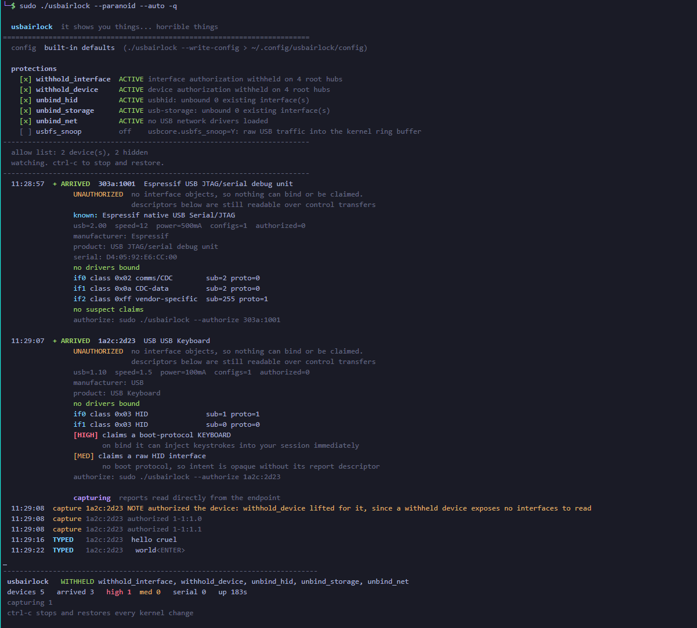

# usbairlock

*it shows you things... horrible things*

Read what a USB device claims before the kernel binds a driver to it, and record what it
does if it turns out to be the sort of device that does things.

An airlock is a chamber you pass through before the thing you are entering. A device
enumerates, its descriptors are read, its claims are judged, and only then does anything
get to bind.

```sh
sudo ./usbairlock --auto        # the usual run: withhold, inspect, record what types
sudo ./usbairlock --auto -q     # same, trusting and hiding what is already plugged in
./usbairlock --observe          # watch only, change nothing, no root
sudo ./usbairlock --paranoid    # every protection on
./usbairlock --status           # what is withheld right now
```

Run it in a spare terminal and plug something in. Arrivals print with their descriptors,
their claimed interfaces and any suspect claims, before a driver touches them.

Every kernel change is reversed on exit, including Ctrl-C, SIGTERM and SIGHUP.



A real `--paranoid --auto` run. Both devices are held `UNAUTHORIZED`, so the kernel
created no interface objects and nothing could bind, yet the descriptors below each one
were still read over control transfers: manufacturer, product, serial, and every
interface the device claims. The keyboard scores `HIGH` on a boot-protocol claim, and the
last two lines are what it typed, read straight off the endpoint. None of it reached the
session.

## what it does that blocking alone does not

A device that claims to be a keyboard can be refused. That tells you it is hostile. It does
not tell you what it was going to do.

`--auto` claims the interface through usbfs instead, so the reports are read directly from
the endpoint and never become input events. The device types its payload into a log while
the machine sits inert:

```
+ ARRIVED  1a2c:2d23  USB Keyboard
           UNBOUND  interfaces present, no driver attached
           if0 class 0x03 HID  sub=1 proto=1
           [HIGH] claims a boot-protocol KEYBOARD
           capturing  reports read directly from the endpoint
  TYPED    1a2c:2d23  hello world<ENTER>
```

Inter-keystroke timing is printed with chords, which is its own tell: a person types
80 to 200 ms apart, an automated payload fires at 5 to 20 ms.

## protections

Each is independent, settable in config or by flag (`--unbind-hid`, `--no-withhold-interface`).

| protection | default | what it does |
| --- | --- | --- |
| `withhold_interface` | **on** | device configures normally, but **no interface binds a driver** |
| `withhold_device` | off | device is held entirely unauthorized. Blunter, see the note |
| `unbind_hid` | off | unbinds and refuses `usbhid`, so a claimed keyboard cannot type |
| `unbind_storage` | off | refuses `usb-storage` autoprobe |
| `unbind_net` | off | refuses USB ethernet and RNDIS, which can hijack DNS and routes |
| `usbfs_snoop` | off | raw USB traffic into the kernel ring buffer. Very loud |

**`withhold_interface` is the default because it is better on both counts** (kernel 4.13+).
Authorization per interface rather than per device means a composite gadget is not
all-or-nothing: you can accept the CDC serial interface of a board while refusing the HID
keyboard interface it also claims. That is precisely the shape of a BadUSB serial adapter,
and device-level gating can only say yes or no to the whole thing.

**Why `withhold_device` is off by default:** it is blunter. A device held entirely
unauthorized exposes no interfaces at all, so nothing can inspect them and `--auto` cannot
capture anything. `withhold_interface` leaves the device configured and readable while still
letting no driver bind. Turn the device gate on with `--withhold-device` or `--paranoid`
when you want both.

**A correction, kept because it was wrong in an instructive way.** `withhold_interface` was
also chosen on a guess that it would avoid the re-enumeration loop cheap HID firmware
falls into. It does not. Observed on a plain USB keyboard with the device authorized and
only its interfaces held: it still reset itself every few seconds, `devnum` climbing each
time and invalidating any `/dev/bus/usb/...` path. The loop comes from nothing claiming
the interface, not from the device being unauthorized. That is why `capture_forever`
re-resolves and reclaims rather than treating a disconnect as fatal.

## the allow list, and hiding

Two separate questions, and collapsing them into one flag made the tool lie about which
was in effect.

**Allowing is policy.** A device on the allow list is trusted: not held, not captured, not
unbound. It is keyed on `vid:pid` and it persists, so a device unplugged and replugged is
still the same trusted device.

**Hiding is display**, and it keys off the allow list rather than off a snapshot taken at
startup. So something merely hidden reappears when it is replugged, because nothing ever
trusted it.

| flag | concern |
| --- | --- |
| `--allow-existing`, `-A` | policy: trust everything currently attached |
| `--allow VID:PID` | policy: trust one device, repeatable, also settable in config |
| `--hide-allowed`, `-H` | display: do not print devices on the allow list |
| `--quiet`, `-q` | both |

The default is to trust nothing and show everything.

This matters more than it sounds. On a desktop the keyboard running the command is very
often USB, and a tool that unbinds `usbhid` from everything the moment it starts takes the
operator's own keyboard away. That is a lockout, not a protection.

Related: `--auto` does not remove `usbhid` globally. It authorizes the target interface and
unbinds the driver **from that interface only**, so every other HID device keeps working,
and rebinds on exit.

The same lockout has a back door that is easy to miss. The kernel copies
`authorized_default` into a device's own `authorized` **once, at enumeration time**, so a
device plugged in mid-session is stuck at `authorized=0` and putting the gate back on exit
does not revive it. It stays dead until it is physically replugged. Anything withheld while
the gate was down is therefore re-authorized on exit, and only that: a device someone
deauthorized for their own reasons is left alone.

## one monitor, many terminals

Two monitors running at once would both apply protections and both register cleanup
handlers over the same sysfs knobs, so whichever exited first would restore them while
the other still believed it was holding. Nothing reported that, and it left the machine
in exactly the state the tool exists to prevent. A second monitor is now refused:

```
$ sudo ./usbairlock --auto
  a monitor is already running (pid 1836045)
  watch it:  sudo ./usbairlock --attach
  override:  --force, only if you are sure the other one is wedged
```

`--attach` opens a read-only view of the running monitor. It sees the same arrivals,
threat lines and captured keystrokes, and it touches nothing: detaching leaves the
monitor holding. `--authorize` from a third terminal admits a device and the monitor
picks it up within a tick.

```
term 1 $ sudo ./usbairlock --auto
term 2 $ sudo ./usbairlock --attach
term 3 $ sudo ./usbairlock --authorize 303a:1001
         authorized 1 device(s): 1-2
         added to the shared allow list, monitor pid 1836045 notified

term 1 + allowed  303a:1001  another process authorized this      <- both terminals
term 2 + allowed  303a:1001  another process authorized this
```

Authorizing writes sysfs, which the monitor would see anyway on its next poll. Recording
it in the shared allow list is the separate half: without that the monitor would withhold
the same device again on the next replug.

State lives in three files under `/run/usbairlock`, which is tmpfs, so all of it is
per-boot:

| file | what it is |
| --- | --- |
| `lock` | `flock` held for the monitor's lifetime, and its pid |
| `allow` | one `vid:pid` per line, re-read every tick |
| `sock` | newline-delimited JSON, one event per line |

Two things that are deliberate. **The socket is root-only, 0600 inside a 0700
directory**, because the stream replays captured HID reports: a viewer channel anyone
could open would turn this into a keylogger with a published socket. And **IPC never
breaks protection**. A read-only filesystem, a stale socket, a viewer that stops reading:
each degrades to a note and the monitor keeps holding. A viewer that stalls past a
megabyte of backlog is dropped rather than allowed to block the poll loop.

`/run` being tmpfs also draws a line worth keeping: `--authorize` means *trust this until
reboot*, while the config file means *trust this always*. Neither silently becomes the
other.

The event stream is the seam a daemon mode would grow from. It is already a versioned
line protocol rather than a private format, so a future `--daemon` and a richer client
would not need to change what the monitor emits.

## the display

Output is a normal scrolling log with a **pinned status block** at the bottom, the shape
`apt` and `docker pull` use: arrivals and removals scroll past, the summary stays put and
repaints in place.

Deliberately not a full-screen TUI. A TUI takes over the terminal, destroys your
scrollback and cannot be copied out of or piped. This keeps an ordinary terminal session
and merely refuses to let the status scroll away. Implemented with the DECSTBM scroll
region and about eighty lines in `airlock/live.py`. `--plain` turns it off, and it turns
itself off when stdout is not a terminal, so piping produces clean text with no escape
codes.

## why not udev rules

udev is userspace and runs **after** the kernel has matched and bound a driver for many
classes. A udev rule that blocks keyboards fires once a malicious keyboard has already
typed. The kernel gate at `/sys/bus/usb/devices/usbN/authorized_default` runs before bind,
which is the only point where the decision is still yours. A device held there still
enumerates, so its descriptors stay readable and inspection keeps working. It simply gets
no driver.

Persistent version, for a box whose job is triage:

```
usbcore.authorized_default=0        # kernel command line
```

## config

Defaults are built in. Drop a file to change them, and any flag still wins:

```sh
./usbairlock --write-config > ~/.config/usbairlock/config
```

Searched in order: `~/.config/usbairlock/config`, then `/etc/usbairlock.conf`.

## what it catches, and what it cannot

Read `notes/threat-model.md`. The short version: this fully covers the BadUSB and Rubber
Ducky class, because that attack has to declare itself in a descriptor before it can act.
It **cannot** see a USB killer, which finishes in microseconds with no enumeration, and it
cannot tell a charge-only cable from an empty port, because both produce the same absence
of any event. Those are physical layer and want the inline hardware tier in `hardware/`.

## two executables, on purpose

| | lines | needs | for |
| --- | --- | --- | --- |
| `airlock-min` | 154 | python3, one file | any box, no install, drop and run |
| `usbairlock` | ~1900 | python3 stdlib | the full thing: protections, capture, config |

**`airlock-min` is the whole idea in one file.** Reads sysfs directly, assesses the
claims, watches for arrivals, and optionally holds the gates. No package, no config, no
`lsusb`, no install. `scp` it onto a machine that has nothing and it works.

**`usbairlock`** adds what a workstation can afford: six independently toggleable
protections, keystroke capture, a config file, and one-shot modes.

Shared between them, and the reason the split is cheap: `airlock/rules.py` is the
analysis core, and it **imports nothing**. No filesystem, no subprocess, no OS calls,
just tables and pure functions over plain data. That is the part worth keeping portable,
because an inline RP2040 build reimplements the plumbing but transliterates those same
tables. Everything Linux-specific lives elsewhere.

## commands

| command | what it does |
| --- | --- |
| `sudo ./usbairlock` | apply protections, then watch. The main mode |
| `./usbairlock --observe` | watch only, change nothing, no root |
| `sudo ./usbairlock --paranoid` | every protection on |
| `./usbairlock --status` | what is protected right now |
| `./usbairlock --inspect [VID:PID]` | one-shot: what is attached and what it claims |
| `./usbairlock --diagnose` | nothing appeared. Why not |
| `sudo ./usbairlock --arm` / `--disarm` | apply or release protections and exit, persistently |
| `sudo ./usbairlock --authorize VID:PID` | admit one device, and share that decision with a running monitor |
| `sudo ./usbairlock --attach` | read-only view of a monitor already running elsewhere |
| `./usbairlock --write-config` | print a config file |

Exit status of `--inspect` is 2 when anything scored HIGH, so it drops into a script.

## requirements

Python 3 and a Linux kernel. That is all.

Devices are enumerated by reading `/sys` directly, so the tool works on a minimal image
with no `usbutils` installed, which is exactly what a triage box tends to be. `lsusb` is
used when present for verbose interface descriptors, and its absence is reported rather
than silently reducing everything to "nothing suspicious".

`tools/identify` and `tools/dump` are the post-airlock hardware step and do want backends
(`esptool`, `picotool`, `dfu-util`, `pyocd`); each reports which are missing and how to
install them.

## tests

```sh
python3 tests/test_threats.py     # threat assessment, synthetic descriptors
python3 tests/test_ipc.py         # lock, shared allow list, viewer channel
python3 tests/test_restore.py     # what exit puts back, including the lockout regression
```

No pytest, no dependencies. These exist because the detector had never fired on real
hardware: every device available for testing was internal and genuinely benign, so "no
suspect claims" was an unfalsified claim. Synthetic descriptors exercise the dangerous
paths, including the BadUSB and Rubber Ducky shapes, without owning either.

## after the airlock: identifying the board

Once a device is admitted, the question becomes what chip it actually is.

### the four steps, every family, every time

1. **Enumerate.** What does the host see? USB IDs, device class, which driver bound.
2. **Identify.** What chip is it actually, from the silicon rather than the silkscreen.
3. **Dump before you write.** The vendor firmware is the only copy of whatever this thing
   does. Reflashing destroys the evidence. Read it out first, always.
4. **Then decide.** Only after the above does it earn a place on a machine that matters.

## why a separate box

A USB device announces what it is, and the host believes it. The dangerous case is not
storage, it is a device that claims to be a **keyboard** and types the moment it
enumerates. "I will just have a look at it first" does not protect you, because looking
happens after enumeration.

`usbguard` is the piece that makes triage real rather than theatrical: it allowlists by
device class **before** the kernel binds a driver. See `notes/threat-model.md`.

## layout

    usbairlock   the app
    airlock/     rules (portable, zero imports), protections, device analysis, live
                 display, and the lock / allow list / viewer channel in ipc.py
    airlock-min  the whole idea in one file, for a box with nothing installed
    tools/       identify and dump: the post-airlock hardware step
    tests/       threat detection and ipc tests
    notes/     per-family reference and the threat model
    dumps/     firmware read out of boards, gitignored (they can be large, and they are
               not ours to redistribute)

## family cheatsheet

| family | enumerates as | identify | dump |
| --- | --- | --- | --- |
| ESP32 S3/C3/C6 | `303a:*` native USB, or a CH340/CP2102 bridge | `esptool chip_id` | `esptool read_flash` |
| ESP8266 | CH340 / CP2102 | `esptool chip_id` | `esptool read_flash` |
| RP2040 / RP2350 | `2e8a:0003` mass storage in BOOTSEL | `picotool info -a` | `picotool save` |
| STM32 | `0483:df11` DFU, or SWD | `dfu-util -l` | `dfu-util -U` |
| AVR / Arduino | CH340 / FT232 | `avrdude -c arduino -p m328p` | `avrdude -U flash:r:` |
| nRF52 | J-Link, DAPLink | `pyocd list` | `pyocd flash --read` |
| any Cortex-M | SWD probe | `openocd` IDCODE scan | target dependent |

## the failure that is not a failure

A board that powers up, drives its screen, and produces **no USB event at all** is not
broken software. The host never saw a connect, so it is electrical: a charge-only cable,
a connector orientation, or a board whose USB-C carries power only.

Special case worth knowing: the **ESP32-C3 native USB Serial/JTAG lives on GPIO18 and
GPIO19**. Vendor firmware that repurposes those pins kills USB the instant it boots. Hold
BOOT (GPIO9), tap RESET, release BOOT to force the ROM bootloader, which reclaims them.
If the board enumerates only in that state, the firmware was stealing the pins.
